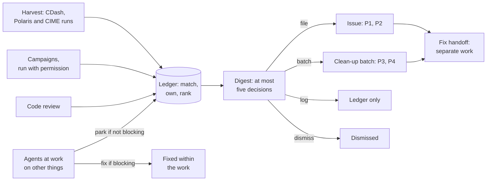

# Bug Hunting for Omega and Polaris

date: 2026/10/27

Contributors:

- Xylar Asay-Davis
- Claude

## Summary

This design adds a bug hunter to Polaris: a utility, `utils/bug_hunt`, and
instructions for the agents that use it. A hunt finds bugs in Omega and
Polaris, ranks them, and hands a developer a short list of decisions.
Developers' attention, more than compute or agent time, limits how many
bugs get fixed. The design is built around spending it well.

Bugs reach developers today in two ways, and both cost attention. Nightly
results sit on CDash, where nothing marks which failures are new. On
2026-10-27, CDash showed 14 failing coupled tests on four rows, and open
issues already covered all of them (Omega#564, #626 and #637). Meanwhile,
agents find bugs while doing other work, and each one becomes either a
detour from that work or an issue of its own. Nothing says which bugs
matter most. Omega has priority labels, but none of its 49 open issues
carries one, and Polaris has none.

A developer starts each hunt. The hunt reads the results that testing
already produces. It can also run tests that do not run regularly, among
them Omega's coupled E3SM tests and two suites of Polaris tasks kept for
hunting, or read recently merged code. Each finding is
matched against what is already known, assigned to the project that owns
it, and ranked. The developer sees at most five decisions per hunt. Minor
bugs go into a few clean-up issues instead of one issue each.

Some of the bugs that agents find while at work on something else block
that work. Those are fixed as part of it, only as far as the work needs.
An agent parks any other bug with one command and returns to its task, and
the next hunt triages what was parked. A hunt never fixes bugs itself.

Omega and Polaris share one hunter. Omega's standalone testing runs through
Polaris, so hunting Omega bugs turns up Polaris bugs, and deciding which
project owns a failure is the first step of triage. The first sources and
campaigns are Omega's. Polaris' own, such as the MPAS-Ocean suites and the
framework's unit tests, can be added later without changing the rest.

Success means that hunts find bugs that no one had tracked, and that a
developer can make every decision a hunt asks for in a few minutes. No bug
is brought to them twice, and agents doing other work fix only what blocks
it and set the rest aside.

## Requirements

### Requirement: A developer starts each hunt.

A hunt covers only what the developer asks for. Nothing runs on a schedule.

### Requirement: Hunts start from the testing that already runs.

Nightly results on CDash, including the coupled E3SM tests, and any Polaris
or CIME runs the developer points to are read before anything new is run.
Each hunt picks up where the previous one stopped.

### Requirement: Hunts can run tests that are not run regularly.

Each such run is chosen from a list that states its cost. The list includes
Omega tasks that no regular suite runs, chosen so that they do not repeat
each other, whether or not they are known to fail.

### Requirement: Hunts can find bugs by reading code.

### Requirement: Each bug is reported once.

A finding that matches an earlier finding, an open issue or an open pull
request adds to that record. A known bug is raised again only when
something about it changes.

### Requirement: Each finding names the project that owns it.

The owner is Omega, Polaris, the rest of E3SM or the machine environment,
or it is unknown.

### Requirement: Each finding carries its evidence.

It says what was seen, where, at which commits, how to reproduce it, when it
was first seen, and whether it was measured, inferred or speculative.

### Requirement: Findings are ranked by priority.

### Requirement: A hunt asks for only a few decisions.

At most five by default, highest priority first. The rest wait, ranked, for
a later hunt.

### Requirement: Minor bugs are batched.

Low-priority bugs are collected by project and theme in a few clean-up
issues rather than filed one at a time.

### Requirement: Nothing reaches another person without the developer's permission.

This covers filing, editing and commenting on issues, submitting jobs and
pushing branches.

### Requirement: An agent can set a bug aside and return to its work.

Parking a bug that does not block the work at hand takes one command and no
investigation. A bug that blocks the work is fixed as part of it, only as
far as the work needs. This holds for agents working in Omega as well as in
Polaris.

### Requirement: Hunted bugs are fixed as separate work.

A hunt does not fix bugs. A bug that a hunt has triaged is fixed on a
branch of its own, from the base branch, one finding or one clean-up batch
at a time.

## Algorithm Design



### Algorithm Design: A developer starts each hunt.

A hunt is a session with an agent that follows `utils/bug_hunt/AGENTS.md`.
The developer says what to hunt, choosing one or more of:

- **harvest**: read testing results;
- **campaign** *name*: run a campaign from the list;
- **review**: read code merged since the last review;
- **triage**: rank what is in the ledger, including parked findings.

By default, a hunt harvests and triages, which costs no compute. The target
is Omega `develop` and Polaris `main` at their current heads, unless the
developer names other commits. Every hunt ends with a digest, even one with
nothing new in it.

```
Hunt Omega bugs following utils/bug_hunt/AGENTS.md: harvest since the
last hunt, then triage.
```

### Algorithm Design: Hunts start from the testing that already runs.

| Source | What ran | Omega commit |
|---|---|---|
| CDash, `unitest-develop-*` builds | the CTests | `develop` |
| CDash, `polaris_omega_nightly-*` builds | `omega_nightly` | Polaris' submodule |
| CDash, `e3sm_omega_developer_develop_*` builds | `e3sm_omega_developer` | `develop` |
| Polaris work directories, including Omega PR testing's baselines | suites and tasks | as in `provenance` |
| CIME test directories | `create_test` runs | as recorded by CIME |

For each failing test on each row, the harvest walks back through the
nights to the last one that passed. It lists the merges into `develop`
between that night and the first failure, which is how Omega#626 was traced
to #512 by hand. A test that alternates between passing and failing with no
merge in between is marked intermittent. The harvest also reports rows that
stopped reporting, since CDash says nothing about a missing build, and rows
whose count of compiler warnings rose.

Polaris' nightly suite runs the Omega commit pinned in Polaris, not
`develop`. A regression on `develop` that only Polaris' suites catch
therefore shows up when someone updates the submodule, usually in the
middle of other work. The `develop` campaign closes that gap on request.

The ledger records the nights and commits each hunt covered, and the next
hunt starts from there.

### Algorithm Design: Hunts can run tests that are not run regularly.

Campaigns are listed in `utils/bug_hunt/campaigns.yaml`, each with what it
runs, on which rows, its rough cost and what it can find. They use the
tools Polaris already has: `polaris suite --build` on a login node,
`omega_ctest.py`, CIME's `create_test` from an Omega checkout, and the job
submission in `utils/pr_testing`. Their results are harvested like any
other run.

| Campaign | Runs | Can find |
|---|---|---|
| `develop` | `omega_pr` on Omega `develop`, against a baseline of Polaris' submodule | failures on `develop` before the submodule is updated |
| `rows` | `omega_nightly` and the CTests on Omega PR template rows with no nightly results (on 2026-10-26, those on pm-gpu, Frontier and Aurora) | failures on one machine or compiler |
| `debug` | the CTests and `omega_pr` with a debug build | out-of-bounds access, floating-point exceptions |
| `coupled` | `e3sm_omega_developer` on rows the nightly skips, its debug tests (commented out of the suite) and `e3sm_omega_integration` | coupled failures |
| `hunt` | the `omega_hunt` suite | failures in features and configurations that `omega_pr` and `omega_nightly` do not exercise |
| `hunt_long` | the `omega_hunt_long` suite: long runs, finer meshes, slow convergence sweeps | drift, conservation errors, late NaNs, failures at scale |

The `rows`, `debug` and `develop` campaigns can run either hunt suite in
place of `omega_pr` or `omega_nightly`.

In the `develop` campaign, a task that fails to run is a finding, but a
difference from the baseline is not (see [Decisions](#decisions)). The
differences are listed in the hunt record.

Omega#644 shows what the `coupled` campaign adds. A debug coupled test,
`PEM_D.T62_oQU240.GOMEGA-IAF` with GNU on Chrysalis, traps a division by
zero. The nightly coupled suite cannot see it, because its debug tests are
commented out.

Only `omega_pr` and `omega_nightly` run regularly with Omega. The other
suites, and the tasks in no suite, run only when someone runs them by hand.
On 2026-10-27, Polaris had 221 ocean tasks that run with Omega. The count
comes from `polaris list` at `335cc496d` and from the models that the
User's Guide says each family of tasks supports:

| Where the task is | Tasks |
|---|---|
| `omega_pr` or `omega_nightly` | 49 |
| only in suites that nothing runs with Omega | 39 |
| no suite | 133 |

The 39 come mostly from the `cosine_bell`, `convergence`, `kpp`,
`omega_analysis` and `sphere_transport_with_viz` suites. Of the 133, 86 are
`realistic_global` tasks across meshes and time steppers and 18 are
`overflow` variants. Most of the rest are from `geostrophic`, `seamount` and
`baroclinic_channel`.

Running all of them is not the goal, since many are expensive and many
repeat each other. Two suites are dedicated to hunting instead.
`omega_hunt` is sized so that any hunt with compute can run it, in a few
node-hours. `omega_hunt_long` holds what is too expensive for that: long
runs, such as a year of `realistic_global` on `e3sm-qu240`, finer meshes
and slow convergence sweeps.

A task belongs in a hunt suite only if it exercises something that
`omega_pr` and `omega_nightly` do not: a feature, a configuration, a longer
run or a larger decomposition. Each family and configuration gets one
representative, and a resolution sweep belongs only where the convergence
rate is the check. A task that is already in another suite gets some extra
weight, since someone chose it for a reason.

A hunt suite may hold tasks that are known to fail, such as the nonlinear
p-star overflow tasks with FCT that go NaN (#894). The ledger tracks such a
failure, so a hunt reports it only when it changes.

### Algorithm Design: Hunts can find bugs by reading code.

A review reads the pull requests merged into Omega `develop` since the last
review, or a part of the code the developer names. It looks only for code
that gives wrong answers or fails: missing halo exchanges, races on GPUs,
out-of-bounds or uninitialized values, inconsistent units or constants. It
ignores style. Each candidate must come with a concrete way it fails, and
is `inferred` unless a test shows it. A review records at most ten
candidates.

### Algorithm Design: Each bug is reported once.

A finding is one bug, and it holds one or more keys. The key of a failing
test is the test name without its machine and compiler, the phase that
failed and the first error message, stripped of numbers, paths and
addresses. The phase is the build, the run, a comparison (restart,
decomposition or threads), the baseline or the time limit. Rows and nights
are occurrences of a finding, not part of its key. For a finding from
reading code or from parking, the key is the file, the function and a short
form of the claim.

The harvest adds each failure to the finding that holds its key. A failure
with a new key is matched, in order, against:

1. the findings in the ledger, where the agent judges whether it shares a
   cause with one, such as several tests that began failing after the same
   merge;
2. open issues and pull requests in Omega and Polaris, searched by test
   name, file, function and error text, with the agent judging whether one
   matches;
3. issues closed in the last 90 days, where a match means the bug is back.

A failure that matches is recorded with the existing finding, along with
links to its issue and to any pull request that would close it. A finding
is raised again only when it changes: a new row or test, a new message, a
failure after its issue was closed, or a failure after its fix was merged.
If a new row turns out to fail for another reason, the agent moves it to a
finding of its own.

The 14 coupled failures of 2026-10-27 are five tests on four rows. Three
open issues cover them: Omega#626 the `PEM` failures on CPUs, and #564 and
#637 the `PEM` and `ERS` failures on GPUs. Once the ledger links them, a
hunt has nothing new to report about them until one of them changes.

### Algorithm Design: Each finding names the project that owns it.

| Owner | Covers | Tracker |
|---|---|---|
| `omega` | Omega's code and build | E3SM-Project/Omega |
| `polaris` | tasks, steps, framework and utilities | E3SM-Project/polaris |
| `e3sm` | other components, CIME, the coupler | E3SM-Project/Omega, labeled `Coupled` |
| `environment` | modules, compilers, file systems, queues, deployment | the developer decides |
| `unknown` | | none until it is known |

Coupling is developed in the Omega repository, so coupled bugs are filed
there first.

Evidence decides the owner. A failing Polaris step that does not run the
model, such as `init` or `viz`, points to Polaris. A coupled failure that a
standalone Omega test also shows points to Omega. One that no standalone
test shows is `unknown` until narrowed down. A failure on one row, while the
same commits pass on others, suggests the environment without showing it.
`unknown` is an acceptable answer, and the digest can offer to look
further.

### Algorithm Design: Each finding carries its evidence.

A finding records:

- the claim, in one sentence;
- what was seen: at most 20 lines of output, with the path or URL they came
  from;
- where: machine, compiler and build type;
- the commits of Omega, Polaris and, for coupled tests, E3SM;
- the commands that reproduce it;
- the last night it passed, the first night it failed and the merges
  between them;
- how sure it is: `measured`, if seen in a test's output or reproduced;
  `inferred`, from code or indirect evidence, with what would disprove it;
  or `speculative`.

The agent stops investigating once a finding can be ranked. Anything more,
such as reproducing it on another row or bisecting with `utils/bisect`, is
offered in the digest with its cost.

### Algorithm Design: Findings are ranked by priority.

| Severity | Meaning | Examples |
|---|---|---|
| S1 | wrong or lost results | answers that depend on decomposition, threads or restarts; runs that do not repeat; broken conservation; output silently overwritten |
| S2 | failure in regular testing | a CTest, an `omega_pr` or `omega_nightly` task, a coupled test or the build fails on a row tested nightly or for pull requests |
| S3 | other failures | failures in debug builds, or in tasks and rows not tested regularly; errors that hide their cause; slowdowns; warnings that point to a fault, such as an uninitialized value |
| S4 | cosmetic | other warnings, names, documentation, log messages, dead code |

| Priority | Findings | Goes to | Label |
|---|---|---|---|
| P1 | S1 measured; S2 measured on more than one row | an issue of its own | `priority: high` |
| P2 | S1 inferred; S2 measured on one row; S3 measured on more than one row | an issue of its own | `priority: medium` |
| P3 | other S3; S2 inferred | a clean-up batch | `priority: low` |
| P4 | S4 | a clean-up batch, below the P3 lines | `priority: low` |

A speculative finding stays in the ledger, whatever its severity, until a
test or a closer reading confirms it. The agent proposes a priority, and the
developer can change it in the digest. A bug that comes back after its
issue was closed moves up one level.

### Algorithm Design: A hunt asks for only a few decisions.

The digest is the only part of a hunt the developer has to read:

```
## Bug hunt 2026-11-03

Omega develop <sha>, Polaris main <sha>. Harvested CDash from 2026-10-28
to 2026-11-03 and triaged 3 parked findings.

### Decisions

1. P2, omega, measured: <claim>. Fails on chrysalis/gnu since
   2026-11-01; merged in between: Omega#<n>. (F-20261103-3fa2)
   Proposed: file. Or: batch, log, dismiss, dig (one debug build,
   about a node-hour).
2. P3, polaris, inferred: <claim>. (F-20261030-07bd)
   Proposed: batch, with logging and error messages.

### For clean-up batches, one decision for all

- polaris, documentation and naming: <claim>. (F-20261029-5c1e)
- omega, compiler warnings: <claim>. (F-20261102-a07f)

### Changed since the last hunt

- Omega#<n>: its fix has merged, but <test> still fails on pm-gpu/gnugpu.

### Not shown

2 speculative findings; 3 tracked bugs unchanged.
```

The developer answers each decision with one word:

- **file**: an issue of its own;
- **batch**: a line in a clean-up batch;
- **log**: kept in the ledger only;
- **dismiss**: not a bug, with a reason, so it is not raised again;
- **dig**: investigate further, at the cost stated.

A digest asks for at most five decisions, unless the developer asks for a
different number, and always includes every P1 finding. Decisions are
ordered by priority, then by the number of rows affected, then by age. The
P4 findings are listed together, one line each, and one answer covers all
of them: `batch` sends them to their batches, and the developer can name
any to leave out. A finding that is not shown keeps its place for a later
digest. A tracked bug
appears, in one line, only when something about it has changed. Commenting
on its issue is a decision like any other.

### Algorithm Design: Minor bugs are batched.

A clean-up batch is an open issue for one project and theme, labeled
`clean up` in Omega or `clean-up` in Polaris, and `priority: low`. Its body
is a checklist with a line per finding. The themes are few and broad:
compiler warnings; logging and error messages; tests and CI; documentation
and naming; and everything else. A P3 or P4 finding that the developer
batches joins the matching open batch, or starts one, with the P4 lines
below the P3 lines.

One pull request fixes a batch and closes it. Small fixes go there rather
than into feature branches.

### Algorithm Design: Nothing reaches another person without the developer's permission.

Filing an issue, adding to a batch, commenting on an issue, submitting a job
and pushing a branch each need the developer's permission, given in the
agent's own session. Each command prints what it would do, and acts only
when given a flag. Writing to the ledger needs no permission each time,
since the ledger exists for this and pushing to it notifies no one.
Building Omega on a login node is not outward-facing.

### Algorithm Design: An agent can set a bug aside and return to its work.

An agent that notices a bug outside the task it was given:

1. fixes it as part of the task, in a commit or branch of its own, if the
   bug blocks the task;
2. otherwise parks it with a one-line claim, its location, the evidence
   already in hand and its confidence, and does not reproduce it, search
   for issues or fix it;
3. says so in one line of its report, such as
   `Parked F-20261027-3fa2: <claim>`.

The same goes for review findings that a pull request did not introduce.
The next hunt triages parked findings with everything else.

A bug blocks the task when the task cannot reach its goal without a fix.
Turning off or working around the failing feature does not make a blocker
a non-blocker if the goal needs that feature to work. When an agent cannot
tell whether a bug blocks its task, it asks the developer.

A blocker is fixed only as far as the task needs. Each bug that the fix
turns up is judged the same way, so that one blocker does not start a
chain of fixes. A blocker in another repository is fixed in a pull request
there. The agent records each blocker in the ledger, with where it is being
fixed, so that hunts do not raise it again.

### Algorithm Design: Hunted bugs are fixed as separate work.

For a finding or batch the developer chooses to fix, the hunt writes a
prompt for a new agent session. The prompt gives the issue, the evidence
and how to reproduce it, the branch to start from (Omega `develop` or
Polaris `main`), and what must pass afterward. The developer decides when
to start that session. A branch fixes one finding or one batch.

## Implementation

### Implementation: A developer starts each hunt.

`utils/bug_hunt/` holds:

- `AGENTS.md`: the hunt procedure, the ranking rubric and the parking rule,
  for agents;
- `README.md`: the same workflow, for people running the commands;
- `bug_hunt.py`, with the subcommands `harvest`, `park`, `match`, `digest`,
  `file`, `handoff` and `status`, and its modules, `bug_hunt_*.py`;
- `campaigns.yaml`: the campaigns.

The modules reuse `utils/pr_testing` for settings, git, GitHub (through
`gh` or the REST API), job submission and the build-warning parser.
Settings go in a `[bug_hunt]` section of the file that
`utils/pr_testing/example.cfg` describes, so the work base and the machines
are shared with PR testing:

```ini
[bug_hunt]
# a clone of the ledger repository
ledger = /path/to/bug-ledger
# the most decisions a digest asks for, besides P1 findings
decisions = 5
# Polaris and CIME work directories to harvest, besides work_base
harvest_roots = /path/to/runs
```

A Developer's Guide page, `docs/developers_guide/bug_hunting.md`, describes
the workflow.

### Implementation: Hunts start from the testing that already runs.

`harvest` reads CDash's JSON API, `api/v1/index.php` for a night's builds
and `api/v1/testOverview.php` for its failing tests. It reads the failed
tests of each build from CDash's GraphQL API. None of these needs a login.
Builds are found by name rather than by group, so moving a build to another
group changes nothing; the coupled builds report to `Experimental` today.

`harvest` also reads `<suite>_results.json` and `provenance` in Polaris work
directories, and `TestStatus` in CIME test directories. The rows that should
report come from `cron-scripts/machines/*.cfg` for the CTests and
`omega_nightly`, and from `campaigns.yaml` for the coupled tests. Merges
between two nights come from the first-parent history of `develop`.

### Implementation: Hunts can run tests that are not run regularly.

```yaml
develop:
  runs: omega_pr on Omega develop against Polaris' submodule
  rows: [chrysalis/intel]
  cost: <node-hours and wall time, measured on the first run>
  finds: failures on develop before the submodule is updated
```

The agent sets up a campaign with the existing tools and submits its jobs
only with permission. `develop` reuses a matching baseline through
`polaris.baselines.find_baseline()`. `coupled` builds with `create_test` on
the login node, from an Omega worktree at the target commit.

The hunt suites are `omega_hunt` and `omega_hunt_long` in
`polaris/suites/ocean`, each with a `.cfg` that sets its job's wall time.
Choosing their tasks, starting from the inventory above, is an early step
of the implementation. After that, keeping them current is a light
maintenance task: the suites are revisited when a new capability or task
reaches Polaris.

### Implementation: Hunts can find bugs by reading code.

The agent reviews with its own tools. `status` lists the pull requests
merged since the last review, and the hunt record keeps the range reviewed.

### Implementation: Each bug is reported once.

The ledger is a git repository, created for the trials in the GitHub
account of the developer running them. It moves to the E3SM-Project
organization once it has proven useful. Its layout is:

```
findings/F-20261027-3fa2.yaml    one file per finding
hunts/2026-10-27.yaml            what the hunt covered, and its decisions
hunts/2026-10-27.md              its digest
```

A finding is a YAML file:

```yaml
schema_version: 1
id: F-20261027-3fa2
keys:
  - {test: PEM_Vmct.T62_oQU240.COMEGA-IAF, phase: compare}
  - {test: PEM_Vmct.T62_oQU240.GOMEGA-IAF, phase: compare}
  - {test: PEM_Vmct_Ln9.TL319_EC30to60E2r2.GOMEGA-JRA1p5.omega-jra_1958,
     phase: compare}
owner: omega
claim: PEM tests fail their comparison on CPUs
severity: S1
confidence: measured
priority: P1
status: tracked   # new, parked, fixing, tracked, batched, logged,
                  # dismissed or fixed
links: [E3SM-Project/Omega#626]
last_passed: 2026-10-06
first_failed: 2026-10-07
merged_between: [E3SM-Project/Omega#512]
occurrences:
  - {night: 2026-10-27, row: chrysalis/intel, source: cdash}
evidence: <excerpt, and where it came from>
reproduce: <commands>
history:
  - {hunt: 2026-10-27, change: matched E3SM-Project/Omega#626}
```

An ID is the date a finding was first recorded and a hash of its first key.
`park` and `harvest` add to an existing finding with the same key rather
than make a new one. `match` checks the ledger by key and prints candidate
issues and pull requests from a GitHub search, and the agent decides. Each
command commits to the ledger and pushes. If a push fails, the commit waits
for the next one.

### Implementation: Each finding names the project that owns it.

`file` chooses the repository from the owner. It adds `bug`, the priority
label, and Omega's machine, compiler and `Coupled` labels where they apply.

### Implementation: Each finding carries its evidence.

`harvest` and `park` fill in what they can, and the agent fills in the
rest. `file` writes the issue from the finding, following the rules for
issues in Polaris' `AGENTS.md`: what happens, what was expected, and how to
reproduce it. The issue ends with the signature that `AGENTS.md`
prescribes.

### Implementation: Findings are ranked by priority.

The rubric is in `utils/bug_hunt/AGENTS.md`. Polaris gets Omega's three
labels: `priority: high`, `priority: medium` and `priority: low`.

### Implementation: A hunt asks for only a few decisions.

`digest` writes the digest from the ledger, enforces the limit and saves it
with the hunt record. The agent shows the digest in its reply, in full. The
commands that act on a decision record it in the hunt record, so no later
hunt asks it again.

### Implementation: Minor bugs are batched.

`file --batch <theme>` adds a line to the theme's open batch issue, found
by its label and title, or prints the issue that would start one. Lines are
added by editing the issue's body, so the batch stays one list.

### Implementation: Nothing reaches another person without the developer's permission.

`file --post` files or edits an issue, and campaign setup submits jobs only
with `--submit`. `utils/bug_hunt/AGENTS.md` lists these flags. It says that
an agent passes one only when the developer has allowed it in that session,
and that the same applies to any `sbatch`, `qsub` or `gh` command run by
hand.

### Implementation: An agent can set a bug aside and return to its work.

```
bug_hunt.py park --claim <text> --where <file:line or test>
                 --owner <omega|polaris|e3sm|environment|unknown>
                 --confidence <measured|inferred|speculative>
                 [--evidence <file>] [--context <the task at hand>]
                 [--fixing <branch or pull request>]
```

`park` refuses a finding without a location or evidence. With `--fixing`,
it records a blocker and where it is being fixed, with the status
`fixing`. Without a ledger configured, it prints the finding, and the agent
puts it in its report. A short section of Polaris' `AGENTS.md`, "Bugs
outside the task", states the rule, including when a bug blocks the task,
and names `park`. An Omega pull request adds the same section to a new
`components/omega/AGENTS.md`. There, `park` runs from a Polaris checkout,
and an agent without one puts the finding in its report.

### Implementation: Hunted bugs are fixed as separate work.

`handoff` prints the prompt:

```
Fix E3SM-Project/Omega#<n> on a new branch from develop, following
utils/bug_hunt/AGENTS.md. The evidence and how to reproduce it are in
the issue. Done when <test> passes on <rows>.
```

## Testing

Unit tests use saved CDash responses and small fixture ledgers. Four trials
check the hunter. The fourth is a real hunt, which must find bugs that no
one has tracked yet:

1. A harvest and triage of CDash from 2026-10-01 to 2026-10-27, into an
   empty ledger.
2. Two weeks in which the agents in one developer's sessions, in Polaris
   and in Omega, park the bugs they find that do not block their work,
   instead of filing or fixing them, followed by a triage hunt.
3. The `coupled` campaign's debug tests with GNU on Chrysalis, at a commit
   where Omega#644 is unfixed.
4. A hunt of current Omega `develop`: a harvest, a review of the last
   month's merges, and the `hunt` and `debug` campaigns on Chrysalis. It
   must turn up bugs that no issue or pull request tracks.

### Testing and Validation: A developer starts each hunt.

Each trial starts from a request like the one in the algorithm design.

### Testing and Validation: Hunts start from the testing that already runs.

Unit tests parse saved CDash responses from 2026-10-06, 2026-10-07 and
2026-10-27, and fixture `<suite>_results.json` and `TestStatus` files. In
the first trial, the harvest places the onset of the `PEM` failures on CPUs
between the nights of 2026-10-06 and 2026-10-07, with Omega#512 among the
merges between them. A second harvest starts where the first stopped.

### Testing and Validation: Hunts can run tests that are not run regularly.

In the third trial, the hunt finds the division by zero and matches it to
Omega#644. Each campaign's cost is measured on its first run and recorded in
`campaigns.yaml`. The first run of `omega_hunt` must fit in a few
node-hours. A task in it that is known to fail, such as one of the #894
tasks, matches its issue and is not raised as new. The fourth trial runs
the `hunt` and `debug` campaigns on current `develop`.

### Testing and Validation: Hunts can find bugs by reading code.

A review of an Omega pull request as it was merged, chosen because a bug in
it was found later, finds that bug. For example, a review of Omega#512
should find what broke the `PEM` tests in Omega#626. In the fourth trial, a
review of the last month's merges into `develop` reports its candidates,
each with the code it rests on.

### Testing and Validation: Each bug is reported once.

Unit tests check that the same failure on four rows gives one key, and that
line numbers, addresses and rank numbers do not change it. In the first
trial, every coupled failure matches Omega#564, #626 or #637, and the
digest asks nothing about them. The trial also needs a split: the `PEM`
tests failed on pm-gpu before they failed on CPUs, for a different tracked
reason. A second harvest of the same nights adds no findings.

### Testing and Validation: Each finding names the project that owns it.

In the first and second trials, the developer checks the owner the hunt
gives each finding.

### Testing and Validation: Each finding carries its evidence.

Unit tests check that `file` refuses a finding without evidence or a way to
reproduce it, and that the issue it writes has each part.

### Testing and Validation: Findings are ranked by priority.

Unit tests rank fixture findings that cover each row of the priority table,
and a bug that came back after its issue was closed.

### Testing and Validation: A hunt asks for only a few decisions.

Unit tests check that a digest asks for no more decisions than the limit,
apart from P1 findings, in the stated order, and that all P4 findings share
one decision. In the second trial, the
developer times each digest, with a goal of five minutes.

### Testing and Validation: Minor bugs are batched.

Unit tests check a batch issue's body before and after a line is added. The
second trial batches at least one finding.

### Testing and Validation: Nothing reaches another person without the developer's permission.

Unit tests check that `file` without `--post`, and campaign setup without
`--submit`, change nothing outside the ledger.

### Testing and Validation: An agent can set a bug aside and return to its work.

Unit tests check that `park` adds to a finding with the same key, and that
it refuses one without a location or evidence. The second trial counts the
findings parked and the blockers fixed. The developer checks that no
session went off course to chase a bug that did not block it, and that
each blocker's fix stayed within what its task needed.

### Testing and Validation: Hunted bugs are fixed as separate work.

The second trial hands at least one finding to a new session with
`handoff`.

## Decisions

- **One hunter for Omega and Polaris, with Omega's sources first.** Hunting
  Omega bugs turns up Polaris bugs, and choosing a failure's owner is the
  first step of triage. Separate hunters would each need the other's
  knowledge to route a finding.
- **Hunts are started by hand.** Harvesting and the digest are the first
  candidates for a schedule, once the ranking has proven itself, since they
  cost no compute and post nothing. Campaigns and filing stay manual.
- **Findings wait in a ledger, not in upstream issues.** An issue
  for every finding would notify everyone watching the repository and ask
  the team to triage. Most findings are minor or already known. A
  `needs triage` label would cost the same.
- **The ledger is a git repository of YAML files.** It works with git
  alone, keeps records structured and keeps their history. Issues in a
  private repository would need `gh` or a token on every machine. A GitHub
  Project would give the team a board, but its draft items hold structured
  records poorly.
- **The ledger starts in the GitHub account of the developer running the
  trials.** Creating a repository in the E3SM-Project organization needs
  one of its owners. Once the ledger has proven useful it moves there, so
  that the whole team can park and triage in it.
- **Scripts harvest, compute keys, write the digest and file. Agents
  investigate, assign owners and rank.** This is the split used for Omega
  PR testing. Scripts do the steps whose mistakes would pass unnoticed,
  such as a skipped night or a decision asked twice.
- **A known bug is not raised again unless it changes.** Repeating a known
  failure costs attention and tells the developer nothing new.
- **Answer changes on `develop` are not findings.** Each pull request's
  changes to answers are accepted at review. The `BFB` and `non-BFB` labels
  could separate intended changes from others, but none of the 69 Omega
  pull requests merged since 2026-08-01 has either.
- **Property checks are not harvested.** Polaris does not fail a task on a
  property check, and #753 is deciding whether it should and with what
  thresholds. Harvesting them now would turn that open question into a
  stream of findings.
- **Low-priority bugs go to clean-up issues upstream, not only to the
  ledger.** Few developers may use the hunter, and the rest see only what
  is in the issue trackers. This holds for cosmetic bugs too. Bugs are
  batched by theme because an issue per finding would cost the team as much
  attention for a typo as for a crash. Only speculative findings wait in
  the ledger, until they are confirmed.
- **A hunt never fixes, and work on other things fixes only its
  blockers.** Parking is for bugs that do not block the work. Telling the
  two apart takes judgment, so the developer settles it when the agent
  cannot.
- **The parking rule goes into Omega's agent instructions as well as
  Polaris'.** Agents working in Omega find many Omega bugs.
- **Two hunt suites, rather than every task that runs with Omega.** Running
  all 221 would cost too much and repeat itself. A routine suite and a long
  one keep the cost of a hunt known. Tasks already grouped in other suites
  get some weight in the choice, but the hunt suites are not built from
  them.
- **Hunt suites may hold known failures, unlike `omega_pr` and
  `omega_nightly`.** A known failure is what a hunt watches for changes, and
  the ledger keeps it from being raised twice. Failing tasks stay out of
  the regular suites.
- **Code coverage is left for later.** An Omega build with coverage would
  show which Omega code the two regular suites never execute, and which
  candidate tasks reach it. The hunt suites are chosen by hand first.
- **A hunt does not propose adding tests to the PR or nightly suites.**
  Suite membership is a cost decision made elsewhere. A finding says which
  test caught it, and no more.
